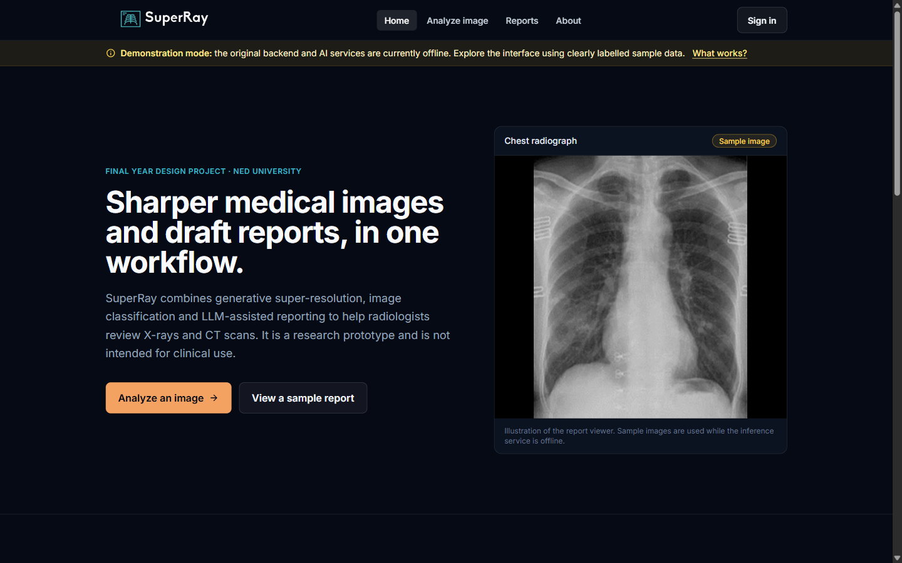
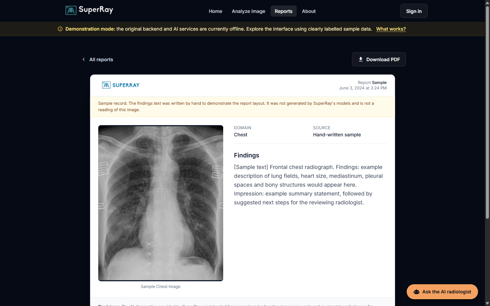
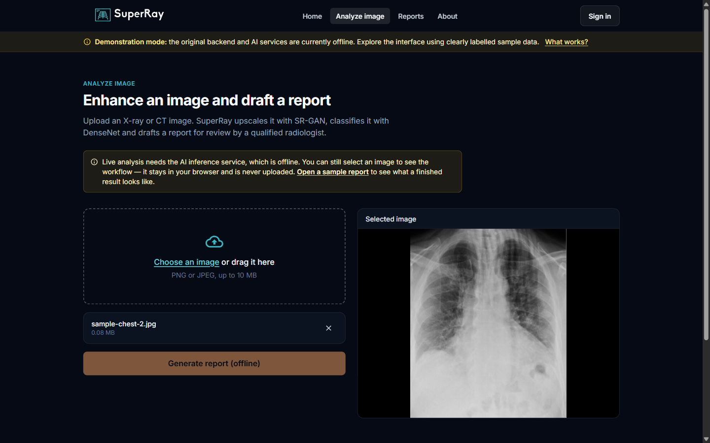
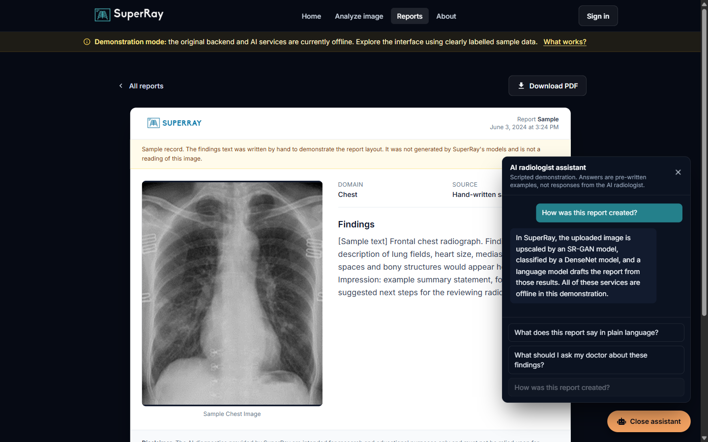
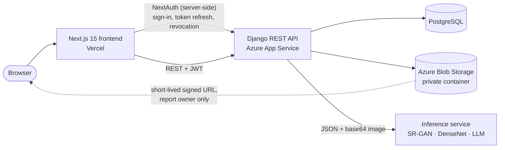

# SuperRay

**AI-assisted medical image enhancement, classification and report drafting.**

SuperRay is a full-stack Final Year Design Project from NED University of Engineering and Technology. A user uploads
an X-ray or CT image. The system upscales it with a generative **SR-GAN** model, classifies it with a **DenseNet**
model, drafts a diagnostic report with a **large language model**, and lets signed-in users save the report and
discuss it with an **AI radiologist chatbot**.

**Live demo:** [superray.vercel.app](https://superray.vercel.app) · **Author:** [Hassan Sohail](https://hassan-sohail.vercel.app/en#projects)

> **Project status.** The original Azure backend and the GPU inference service are no longer running, so the live
> site runs in **demonstration mode** with clearly labelled sample data. The complete frontend and backend code is in
> this repository and runs locally, including with Docker. The trained models are not included.
>
> SuperRay is a research prototype. It is not a medical device and must not be used for clinical decisions.

## Screenshots

Captured from this codebase in demonstration mode. Anything marked "Sample" is demonstration data, not model output.

| Landing page | Report viewer |
| --- | --- |
|  |  |

| Image analysis workflow | AI radiologist chat (scripted in demo mode) |
| --- | --- |
|  |  |

More screenshots, including mobile views, are in the [frontend README](SuperRay-Frontend/README.md#screenshots).

## What it does

1. **Upload:** drag and drop a PNG or JPEG scan. The browser validates it, and the API checks format, size and pixel
   count again.
2. **Enhance:** an SR-GAN model upscales the image to recover fine detail.
3. **Classify:** a DenseNet model identifies the imaging domain (for example, chest) and rejects non-medical images.
4. **Draft a report:** a language model writes a draft report for a radiologist to review.
5. **Save and discuss:** signed-in users save reports, export them as PDF, and ask follow-up questions in a chat
   grounded in the saved report and image.

## Architecture



Engineering highlights:

- **Ownership-scoped access:** reports, images and chat are filtered by the authenticated user on the server. Other
  users' records return 404. In production, uploaded medical images are served only through expiring signed URLs.
- **Token handling:** NextAuth keeps the backend refresh token in an encrypted HTTP-only cookie, refreshes access
  tokens on the server and revokes the refresh token on sign-out.
- **Verified Google sign-in:** Google ID tokens are checked against Google's signing keys before an account is
  linked.
- **Failure handling:** the inference client uses timeouts and typed errors, so an unavailable model returns a clear
  503 instead of a crash. Inference endpoints are rate-limited.
- **Honest demonstration mode:** the deployed frontend uses labelled sample data when the backend is unavailable, and
  never presents sample data as model output.
- **Configuration and testing:** every secret comes from environment variables, and 38 backend tests plus frontend
  lint and build checks run in CI.

## Repository layout

| Path | Contents |
| --- | --- |
| [`SuperRay-Frontend/`](SuperRay-Frontend) | Next.js frontend: pages, components, auth, demo data ([README](SuperRay-Frontend/README.md)) |
| [`SuperRay-Backend/`](SuperRay-Backend) | Django REST API: models, views, inference client, tests ([README](SuperRay-Backend/README.md)) |
| [`compose.yaml`](compose.yaml) | Runs PostgreSQL, the API and the frontend together |
| [`.github/workflows/ci.yml`](.github/workflows/ci.yml) | Backend checks and tests; frontend lint and build |

| Layer | Technology |
| --- | --- |
| Frontend | Next.js 15 (App Router), React 19, Tailwind CSS, NextUI, NextAuth, Axios, Formik/Yup, `@react-pdf/renderer` |
| Backend | Django 5, Django REST Framework, SimpleJWT, django-allauth, django-storages, WhiteNoise, Gunicorn |
| Data | PostgreSQL, Azure Blob Storage |
| ML (external) | SR-GAN, DenseNet, LLM, served by a separate inference service |
| Delivery | Vercel, Azure App Service, Docker, GitHub Actions |

## Running locally

Three options, from quickest to most complete.

### Option 1: Frontend only, demo mode (no backend needed)

Requires Node.js 20 or later.

```bash
cd SuperRay-Frontend
npm install
cp .env.example .env.local
npm run dev                     # http://localhost:3000
```

### Option 2: Full stack with Docker Compose

Requires Docker. This starts PostgreSQL, the Django API on port 8000 and the frontend on port 3000.

```bash
cp .env.example .env            # then set DJANGO_SECRET_KEY and NEXTAUTH_SECRET
docker compose up --build
```

Open <http://localhost:3000>, create an account and sign in. Accounts, saved reports and uploaded images persist in
Docker volumes. Run `docker compose down -v` to remove them.

- Image analysis and chat need the external inference service. Without `INFERENCE_SERVICE_URL`, the app shows a
  clear "service unavailable" message. To use a service running on your machine, set
  `INFERENCE_SERVICE_URL=http://host.docker.internal:<port>/process_json`.
- If ports 3000 or 8000 are in use, change `FRONTEND_PORT` and `BACKEND_PORT` in `.env`.
- This Compose stack is for local use: it runs Django with `DEBUG` on over plain HTTP.

### Option 3: Full stack without Docker

Requires Python 3.11 and Node.js 20 or later. Run each app in its own terminal.

```bash
# Terminal 1: API on http://127.0.0.1:8000
cd SuperRay-Backend
python -m venv env
source env/bin/activate         # Windows: env\Scripts\activate
pip install -r requirements.txt
cp .env.example .env            # local defaults: SQLite, media on disk
python manage.py migrate
python manage.py runserver
```

```bash
# Terminal 2: frontend on http://localhost:3000
cd SuperRay-Frontend
npm install
cp .env.example .env.local      # then set NEXT_PUBLIC_DEMO_MODE=false
npm run dev
```

### Configuration

Each part has a documented `.env.example`. Only placeholders are committed; real `.env` files are git-ignored.

| File | Used by |
| --- | --- |
| [`.env.example`](.env.example) | Docker Compose |
| [`SuperRay-Backend/.env.example`](SuperRay-Backend/.env.example) | Django API (local `.env` or Azure App Settings) |
| [`SuperRay-Frontend/.env.example`](SuperRay-Frontend/.env.example) | Next.js (`.env.local` or Vercel environment variables) |

## Tests

```bash
cd SuperRay-Backend
DJANGO_SECRET_KEY=test DJANGO_DEBUG=false DJANGO_ALLOWED_HOSTS=testserver DJANGO_SECURE_SSL_REDIRECT=false \
  python manage.py test superRayApp

cd ../SuperRay-Frontend
npm run lint && npm run build
```

The backend suite covers authentication, token revocation, report ownership, upload validation, inference error
handling and throttling, chat access control and Google ID-token verification. CI runs the same checks on every push.

## Deployment

- **Frontend (Vercel):** import this repository, set **Root Directory** to `SuperRay-Frontend`, and add the
  variables from its `.env.example`. Without a backend, leave `NEXT_PUBLIC_DEMO_MODE` unset to serve the demo.
- **Backend (Azure App Service or any container host):** deploy `SuperRay-Backend` from source or
  through its `Dockerfile`, with PostgreSQL and a private Blob Storage container. See the
  [backend README](SuperRay-Backend/README.md#deployment-azure-app-service).

## Team

| Member | Role |
| --- | --- |
| Hassan Sohail | Full-stack development (frontend, backend, deployment) |
| Sabih ur Rahman | Machine learning |
| Jamal Khan | Machine learning |

Developed as a Final Year Design Project at NED University of Engineering and Technology, Karachi.
