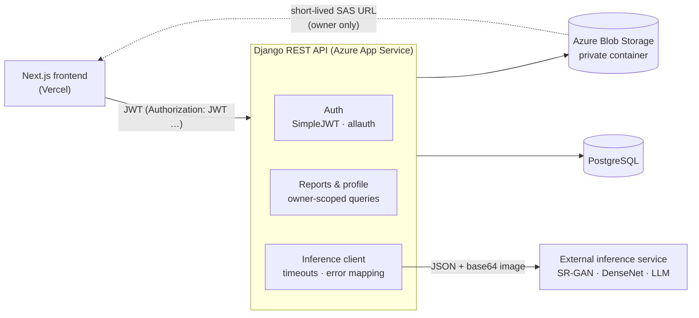

# SuperRay Backend API

Django REST Framework backend for **SuperRay**, an AI-assisted medical imaging platform built as a Final Year Design
Project at NED University of Engineering and Technology. The API handles accounts, image uploads, report storage and
access control, and brokers requests to an external GPU inference service that runs the **SR-GAN** (super-resolution),
**DenseNet** (classification) and **LLM** (report drafting and chat) models.

This folder contains the backend. The Next.js frontend is in
[`../SuperRay-Frontend`](../SuperRay-Frontend), and the [root README](../README.md) explains how to
run the whole stack, including with Docker Compose.

> **Status:** the original Azure deployment and the inference service (a notebook exposed through a tunnel) are
> offline. The code runs locally and its test suite passes. The ML models themselves are not part of this
> repository.

## Architecture



The flow for one analysis:

1. `POST /api/super-resolution/` receives an image, validates it (PNG/JPEG, size and pixel limits) and forwards it to
   the inference service.
2. The service returns an upscaled image, the detected domain (e.g. `chest`) and a draft report. A non-medical
   image is rejected with HTTP 400, which the API returns as `403 {"code": "not_medical_image"}`.
3. A signed-in user saves the result with `POST /api/save-report`. The image is stored in private blob storage and
   linked to the user.
4. `POST /api/chat/` asks follow-up questions about a saved report. The API loads the report (owner only) and sends
   the stored image on the first message only.

## Tech stack

| Area | Choice |
| --- | --- |
| Framework | Django 5.0, Django REST Framework 3.14 |
| Auth | `djangorestframework-simplejwt` (with token blacklist), `dj-rest-auth` + `django-allauth` for Google |
| Database | PostgreSQL (Azure Database for PostgreSQL); SQLite for local development |
| Media storage | Azure Blob Storage through `django-storages`, served as signed SAS URLs |
| Static files | WhiteNoise |
| Server | Gunicorn on Azure App Service (Python 3.11) |
| CI | GitHub Actions (`.github/workflows/ci.yml` at the repository root): system check, migration check, tests |
| Containers | `Dockerfile` (Gunicorn) and the root `compose.yaml` with PostgreSQL |

## API

All paths are prefixed with `/api/`. Authenticated endpoints expect `Authorization: JWT <access token>`.

| Method | Path | Auth | Description |
| --- | --- | --- | --- |
| `POST` | `token/` | Public | Obtain an access/refresh pair (`username`, `password`) |
| `POST` | `token/refresh/` | Public | Exchange a refresh token for a new access token |
| `POST` | `register/` | Public | Create an account |
| `POST` | `logout/` | Refresh token | Blacklist a refresh token (`refresh_token`) |
| `POST` | `google/` | Public | Exchange a Google ID token (`access_token`) for a JWT pair; the signature is verified against Google's keys |
| `GET` | `profile/` | JWT | Current user's profile and reports |
| `PUT` | `profile/update/` | JWT | Update `first_name`, `last_name`, `phone_number`, `sex` |
| `GET` | `reports` | JWT | Current user's reports, newest first |
| `GET` | `reports/<id>/` | JWT | One report; returns 404 for other users' reports |
| `POST` | `save-report` | JWT | Multipart: `image`, `diagnose`, `domain` |
| `POST` | `super-resolution/` | Optional | Multipart: `image`. Returns `{image (base64 JPEG), xreport, domain}` |
| `POST` | `chat/` | JWT | `{report_id, prompt, ack_client}`. Returns `{response, ack}` |

Error responses use `{"error": "...", "code": "..."}` for inference failures: `503 inference_unavailable` when the
service is not configured or unreachable, `502 inference_error` for an unusable response. Validation errors use DRF's
field-error format.

Inference endpoints are rate-limited (`INFERENCE_THROTTLE_ANON`, `INFERENCE_THROTTLE_USER`) because each request
consumes GPU time.

## Security model

- Every endpoint requires authentication unless it is explicitly public (the default permission is `IsAuthenticated`).
- Reports, report images and chat are scoped to the requesting user; other users' records return 404.
- Uploaded medical images live in a **private** blob container. The API returns signed URLs that expire after
  `AZURE_URL_EXPIRATION_SECS`, and only to the report's owner.
- Uploads are decoded with Pillow and limited by format (PNG/JPEG), file size and pixel count.
- Secrets come only from environment variables. When `DJANGO_DEBUG` is off, the app refuses to start without
  `DJANGO_SECRET_KEY`.
- CORS is restricted to `CORS_ALLOWED_ORIGINS`. Production enables HTTPS redirects, HSTS and secure cookies.
- Inference errors are logged server-side without report contents and are never echoed to clients.

## External inference service

The models run outside this repository. Set `INFERENCE_SERVICE_URL` to an endpoint that accepts `POST` JSON:

| Request | Response |
| --- | --- |
| `{"image": "<base64 PNG>", "options": "ganllm"}` | `200 {"upscaled_image": "<base64>", "domain": "chest", "response": "<report>", "diff_diag": "..."}` or `400` for a non-medical image |
| `{"image": "<base64 PNG>" \| null, "options": "historic", "new": bool, "report": "<text>", "prompt": "<question>"}` | `200 {"response": "<answer>"}` |

Requests time out after `INFERENCE_TIMEOUT_SECONDS`. Without `INFERENCE_SERVICE_URL`, analysis and chat endpoints
return `503`.

## Local development

Requirements: Python 3.11.

```bash
python -m venv env
source env/bin/activate       # Windows: env\Scripts\activate
pip install -r requirements.txt
cp .env.example .env          # local defaults: DEBUG on, SQLite, media on disk
python manage.py migrate
python manage.py runserver    # http://127.0.0.1:8000
```

Settings are read from environment variables. A `.env` file in this folder is loaded for convenience, and real
environment variables (for example Azure App Settings) take precedence over it. With the example values the API uses
SQLite and stores uploads in `media/` (served only while `DJANGO_DEBUG=true`). Analysis and chat return `503` until
`INFERENCE_SERVICE_URL` is set.

### Tests

```bash
DJANGO_SECRET_KEY=test DJANGO_DEBUG=false DJANGO_ALLOWED_HOSTS=testserver DJANGO_SECURE_SSL_REDIRECT=false \
  python manage.py test superRayApp
python manage.py makemigrations --check --dry-run
python manage.py check --deploy    # with production variables set
```

The suite (38 tests) covers registration and login, token blacklisting, profile field restrictions, report ownership,
upload validation, inference error handling and throttling (with the inference service mocked), chat ownership, Google
ID-token signature verification and the production secret-key check.

## Configuration

See [`.env.example`](.env.example) for every variable.

| Variable | Required | Description |
| --- | --- | --- |
| `DJANGO_SECRET_KEY` | Production | Django signing key, also used to sign JWTs |
| `DJANGO_DEBUG` | No | `true` for local development only (default `false`) |
| `DJANGO_ALLOWED_HOSTS` | Production | Comma-separated host names |
| `DJANGO_CSRF_TRUSTED_ORIGINS` | Production | Origins for the Django admin over HTTPS |
| `CORS_ALLOWED_ORIGINS` | Production | Frontend origins allowed to call the API |
| `POSTGRES_HOST`, `POSTGRES_DB`, `POSTGRES_USER`, `POSTGRES_PASSWORD`, `POSTGRES_PORT`, `POSTGRES_SSLMODE` | Production | PostgreSQL connection; SQLite is used when `POSTGRES_HOST` is unset |
| `AZURE_ACCOUNT_NAME`, `AZURE_ACCOUNT_KEY`, `AZURE_MEDIA_CONTAINER`, `AZURE_URL_EXPIRATION_SECS` | Production | Private media storage; the local filesystem is used when unset |
| `GOOGLE_CLIENT_ID`, `GOOGLE_CLIENT_SECRET` | No | Google sign-in |
| `INFERENCE_SERVICE_URL`, `INFERENCE_TIMEOUT_SECONDS` | For analysis | External model endpoint |
| `INFERENCE_THROTTLE_ANON`, `INFERENCE_THROTTLE_USER` | No | Rate limits, e.g. `10/hour` |
| `MAX_UPLOAD_SIZE_MB` | No | Upload limit (default 10) |
| `JWT_ACCESS_TOKEN_MINUTES`, `JWT_REFRESH_TOKEN_DAYS` | No | Token lifetimes (defaults 60 minutes, 7 days) |

## Deployment (Azure App Service)

1. Create the App Service (Python 3.11), the PostgreSQL server and a storage account with a **private** `media`
   container.
2. Add the variables above under **App Service → Configuration → Application settings**.
3. Set the startup command: `gunicorn --bind=0.0.0.0 --timeout 180 superray.wsgi`.
4. Under **Storage account → Resource sharing (CORS)**, allow `GET` from the frontend origin so the browser can embed
   report images in PDFs.
5. Deploy this folder, for example with `az webapp up` or the App Service Deployment Center (set the app root to
   `SuperRay-Backend`), or deploy the `Dockerfile` image to App Service for Containers. Run
   `python manage.py migrate` against the production database after deploying model changes.

The repository's GitHub Actions workflow runs the checks and tests on every push; it does not deploy.

The migration history was consolidated into `superRayApp/migrations/0001_initial.py`, which matches the existing
production schema. A database that already applied the earlier migrations treats it as applied.

## Known limitations

- The ML models and the inference service are not included. Without them, analysis and chat return `503`.
- Django 5.0 has reached end of life. Upgrading to Django 5.2 LTS also requires newer releases of DRF,
  `django-allauth` and `dj-rest-auth`.
- `django-allauth` 0.52 does not verify Google ID tokens supplied by a client; this project patches that in
  `superRayApp/adapters.py`. Upgrading the package is still recommended.

## Team

- Hassan Sohail: full-stack development
- Sabih ur Rahman: machine learning
- Jamal Khan: machine learning
