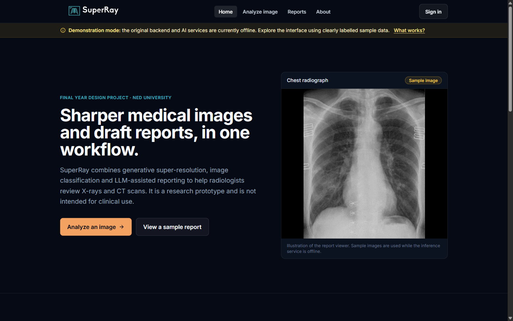
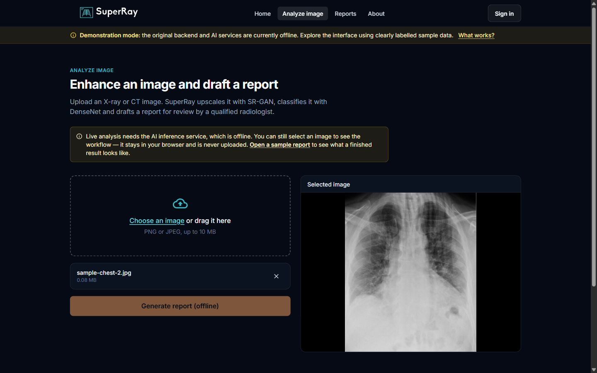
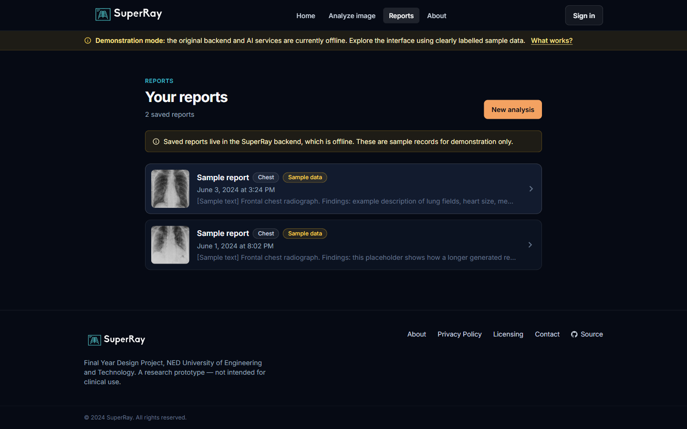
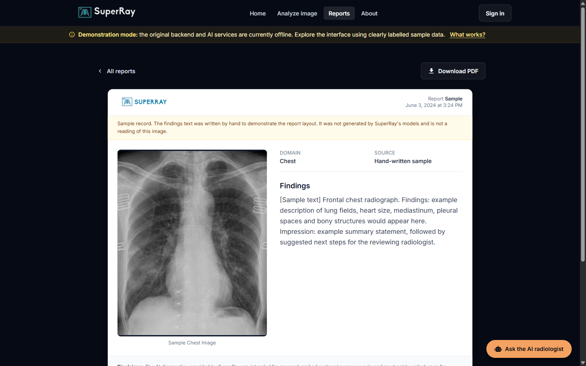
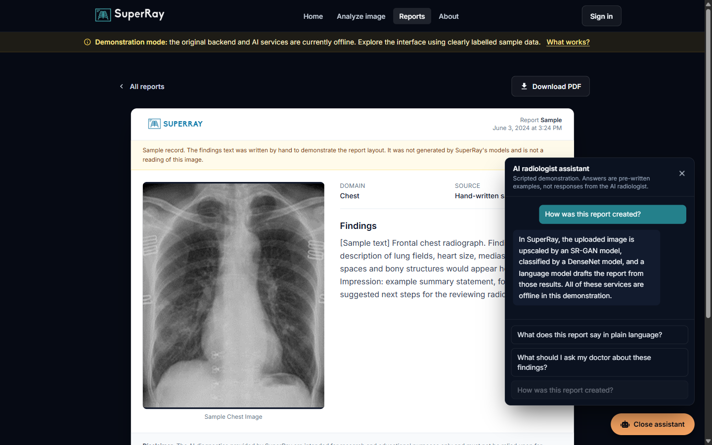
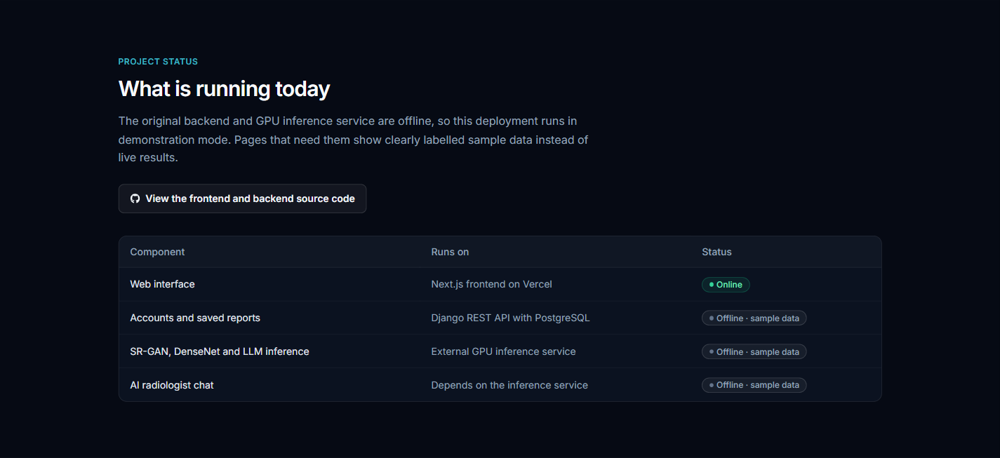
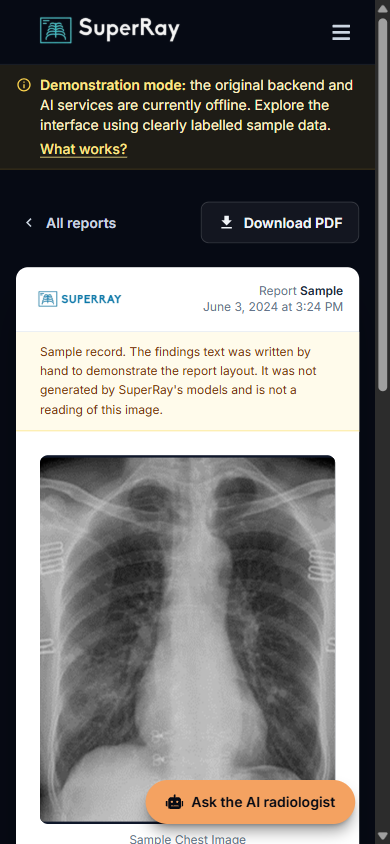
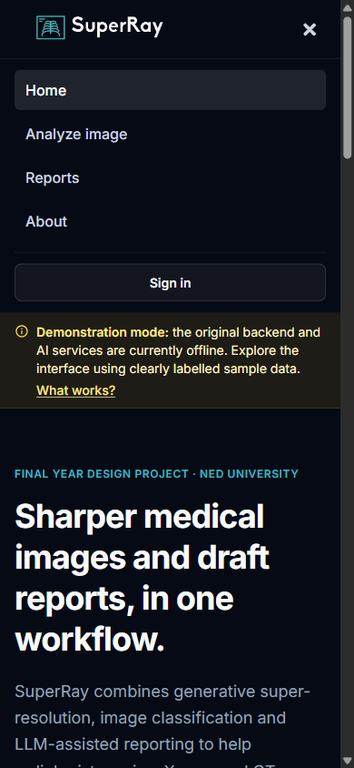

# SuperRay Frontend

SuperRay is an AI-assisted medical imaging platform built as a Final Year Design Project at NED University of
Engineering and Technology. A user uploads an X-ray or CT image; the system upscales it with an **SR-GAN** model,
classifies it with a **DenseNet** model, drafts a diagnostic report with a **large language model**, and lets
signed-in users save the report and discuss it with an **AI radiologist chatbot**.

This folder contains the Next.js frontend. The Django REST API is in
[`../SuperRay-Backend`](../SuperRay-Backend), and the [root README](../README.md)
explains how to run the whole stack, including with Docker Compose.

> **Current status:** the original Azure backend and the GPU inference service are offline. The public deployment
> at [superray.vercel.app](https://superray.vercel.app) runs in **demonstration mode**, which uses clearly labelled
> sample data instead of live results. See [Demonstration mode](#demonstration-mode).
>
> SuperRay is a research prototype. It is not a medical device and must not be used for clinical decisions.

## Screenshots

All screenshots were captured from this codebase running in demonstration mode. Images and report text marked
"Sample" are demonstration data, not model output.

| Landing page | Image analysis workflow |
| --- | --- |
|  |  |

| Saved reports | Report viewer |
| --- | --- |
|  |  |

| AI radiologist chat (scripted in demo mode) | Project status |
| --- | --- |
|  |  |

| Mobile report view | Mobile navigation |
| --- | --- |
|  |  |

## Features

- **Image analysis** (`/upload`): drag-and-drop or file picker with client-side type and size validation, a local
  preview, and a side-by-side view of the original and the SR-GAN enhanced image with the drafted report.
- **Report management** (`/reports`, `/reports/[id]`): paginated list of saved reports, a printable report viewer,
  and client-side PDF export with `@react-pdf/renderer`.
- **AI radiologist chat**: a chat panel on each report. The report image is sent with the first message only, as the
  inference service keeps the conversation state.
- **Accounts**: registration, username/password sign-in and optional Google sign-in through NextAuth, plus a
  profile page for editing personal details.
- **Honest failure states**: every data-driven page has loading, empty, error-with-retry and "sign in required"
  states, and API errors are mapped to readable messages (for example, a 503 from the inference service).

## Tech stack

| Area | Choice |
| --- | --- |
| Framework | Next.js 15 (App Router), React 19 |
| Styling | Tailwind CSS 3, NextUI components |
| Auth | NextAuth v4 (credentials + Google) on top of the backend's JWTs |
| HTTP | Axios with a shared client and an auth interceptor |
| Forms | Formik + Yup |
| PDF | `@react-pdf/renderer`, loaded on demand |
| Contact form | Firebase Firestore (client SDK) |
| Hosting | Vercel |

## Architecture

```
Browser ──► Next.js (Vercel)
              ├─ App Router pages (client components for data-driven views)
              ├─ /api/auth/[...nextauth]  ──► Django REST API  /api/token/, /api/token/refresh/, /api/google/, /api/logout/
              └─ Axios (utils/axios.js)   ──► Django REST API  /api/super-resolution/, /api/save-report, /api/reports, /api/chat/ …
                                                   └─► External inference service (SR-GAN · DenseNet · LLM)
```

Key modules:

| Path | Purpose |
| --- | --- |
| `utils/config.js` | Single source of the backend URL and the demo-mode switch |
| `utils/axios.js` | Shared Axios instances and timeouts (inference requests allow up to 150 s) |
| `utils/hooks/useAxiosAuth.js` | Attaches the access token and retries once after a server-side token refresh |
| `utils/media.js` | Converts image references from the API into browser-loadable URLs |
| `utils/errors.js` | Maps API errors to user-facing messages and field errors |
| `utils/demo.js` | All demonstration data, kept separate from live API code |
| `app/api/auth/[...nextauth]/route.js` | Sign-in, server-side token refresh and token revocation on sign-out |

### Authentication

NextAuth exchanges credentials (or a Google ID token) for the backend's JWT pair. The refresh token is stored only in
NextAuth's encrypted, HTTP-only session cookie; the browser receives the short-lived access token. When the access
token is about to expire, NextAuth refreshes it server-side. Signing out blacklists the refresh token on the backend.
Authorization is enforced by the backend; the frontend only hides controls for convenience.

### Images and media URLs

The backend returns absolute image URLs. In production these are short-lived signed Azure Blob Storage URLs that are
only issued to the report's owner, so the frontend never needs storage credentials. For a local backend that returns
relative `/media/...` paths, `resolveMediaUrl()` resolves them against the backend origin. Missing or expired images
show a placeholder instead of a broken image.

## Demonstration mode

Demonstration mode is **on by default**. It is turned off only when `NEXT_PUBLIC_DEMO_MODE=false` and
`NEXT_PUBLIC_BACKEND_URL` are both set, so a deployment never presents an unreachable backend as working.

In demonstration mode:

- A banner on every page explains that the backend and AI services are offline.
- `/reports` and `/reports/sample-*` show two sample reports. Each is labelled "Sample", and the report text says it was
  written by hand and is not a reading of the image. The sample X-rays are crops of an existing project asset.
- The chat panel offers three scripted questions with pre-written answers, labelled as scripted.
- The upload page lets visitors select an image to see the workflow. The image stays in the browser; the
  "Generate report" button is disabled.
- Sign-in, registration and the profile page explain that accounts need the backend.

When live mode is enabled, failures are shown as errors. The app never silently switches to sample data.

## Getting started

Requirements: Node.js 20 or later and npm.

```bash
npm install
cp .env.example .env.local   # works as-is for demo mode; set NEXTAUTH_SECRET for production builds
npm run dev                  # http://localhost:3000
```

The example file starts the app in demo mode, which needs no backend. To run against a local backend, start the
Django API (see its [README](../SuperRay-Backend/README.md)) and set `NEXT_PUBLIC_DEMO_MODE=false`
in `.env.local`. `NEXT_PUBLIC_BACKEND_URL` already points at `http://127.0.0.1:8000/api/`.

### Environment variables

| Variable | Scope | Required | Description |
| --- | --- | --- | --- |
| `NEXT_PUBLIC_BACKEND_URL` | Public, build time | Live mode | API base URL including `/api/`, e.g. `https://api.example.com/api/` |
| `NEXT_PUBLIC_DEMO_MODE` | Public, build time | No | Demo mode is on unless this is exactly `false` |
| `NEXT_PUBLIC_FIREBASE_*` | Public, build time | No | Firebase web config for the contact form (see `.env.example`); the form is disabled while unset |
| `NEXTAUTH_URL` | Server | Production | Canonical URL of the frontend |
| `NEXTAUTH_SECRET` | Server, secret | Yes | Random string used to encrypt session cookies |
| `INTERNAL_BACKEND_URL` | Server | No | Backend URL for server-side calls when it differs from the browser's (e.g. `http://backend:8000/api/` in Docker) |
| `GOOGLE_CLIENT_ID` | Server | No | Enables Google sign-in (must match the backend) |
| `GOOGLE_CLIENT_SECRET` | Server, secret | No | Google OAuth client secret |

`NEXT_PUBLIC_*` values are inlined into the browser bundle at build time, so they must never contain secrets. Changing
them on Vercel requires a redeploy. The previously used `BACKEND_URL` and `NEXT_PUBLIC_IMAGE_URL` variables are no
longer read.

### Scripts

| Command | Description |
| --- | --- |
| `npm run dev` | Development server |
| `npm run lint` | ESLint (`next/core-web-vitals`) |
| `npm run build` | Production build |
| `npm start` | Serve the production build |

## Deployment (Vercel)

1. Import the repository in Vercel and set **Root Directory** to `SuperRay-Frontend`.
2. Set the environment variables above in **Vercel → Project → Settings → Environment Variables**. For the public demo,
   only `NEXTAUTH_SECRET` and `NEXTAUTH_URL` are needed.
3. For live mode, add the frontend origin to the backend's `CORS_ALLOWED_ORIGINS`. If PDF export should include
   images, also allow it in the Azure Blob Storage CORS rules (GET).
4. Redeploy so that public variables are rebuilt into the bundle.

A `Dockerfile` is also included; `NEXT_PUBLIC_*` values are passed as build arguments. See the root
[`compose.yaml`](../compose.yaml) for an example.

## Team

- Hassan Sohail: full-stack development
- Sabih ur Rahman: machine learning
- Jamal Khan: machine learning
